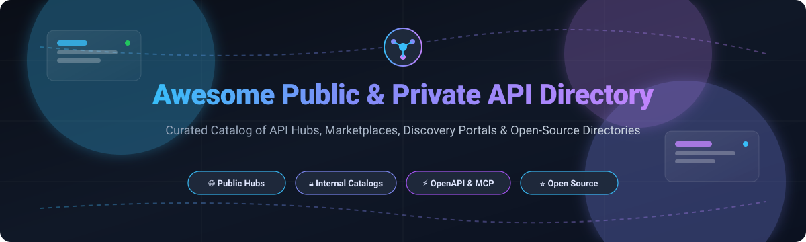

<picture>
  <source media="(prefers-color-scheme: dark)" srcset="assets/banner.svg">
  <source media="(prefers-color-scheme: light)" srcset="assets/banner.svg">
  
</picture>

# 🌐 Awesome Public &amp; Private API Directory 🚀

  <strong>🌟 A comprehensive, SEO-optimized directory of top Public and Private API Directory platforms, commercial API marketplaces, internal API catalogs, developer portals, and open-source OpenAPI registries. 🔍</strong>

  <a href="#-sector-overview--market-dynamics">📈 Sector Overview</a> •
  <a href="#-saas--hosted-commercial-platforms">🏢 SaaS Platforms</a> •
  <a href="#-open-source-software-and-curated-directories">💻 Open-Source Solutions</a> •
  <a href="#-feature-comparison-matrix">📊 Comparison Matrix</a> •
  <a href="#-support--sponsor">💖 Support &amp; Sponsor</a> •
  <a href="#-star-history">⭐ Star History</a> •
  <a href="#-contributing">🤝 Contributing</a>

---

## 📋 Table of Contents 📑

- [📈 Sector Overview & Market Dynamics 🌐](#-sector-overview--market-dynamics-)
- [🏢 SaaS / Hosted Commercial Platforms ☁️](#-saas--hosted-commercial-platforms-️)
  - [📊 Commercial Directory Comparison Table](#-commercial-directory-comparison-table)
  - [🔍 Platform Deep Dives](#-platform-deep-dives)
- [💻 Open-Source Software and Curated Directories 🐧](#-open-source-software-and-curated-directories-)
  - [⭐ Open-Source Solutions (Ranked by GitHub Stars)](#-open-source-solutions-ranked-by-github-stars)
- [📊 Feature Comparison Matrix 🧩](#-feature-comparison-matrix-)
- [💖 Support & Sponsor ☕](#-support--sponsor-)
- [⭐ Star History 📈](#-star-history-)
- [🤝 Contributing 💡](#-contributing-)
- [📄 License 📜](#-license-)

---

## 📈 Sector Overview & Market Dynamics 🌐

The global API management, directory, and marketplace sector was valued at approximately **$7.7 billion in 2024** and is projected to expand to **$21.4B–$47.0B by 2030** at a compound annual growth rate (CAGR) of roughly **16% to 25%** 🚀. The market exhibits moderate fragmentation overall, with high concentration in the enterprise API testing and workspace layer (dominated by Postman) alongside specialized commercial marketplaces like RapidAPI, while internal enterprise API cataloging and OpenAPI developer portals remain competitive and rapidly growing across cloud hyperscalers and open-source ecosystems 🛡️.

---

## 🏢 SaaS / Hosted Commercial Platforms ☁️

Commercial, cloud-hosted public and private API directory platforms offering API hubs, developer marketplaces, internal cataloging, and collaboration workspaces 🛠️.

### 📊 Commercial Directory Comparison Table

Sorted descending by estimated company size (market valuation / enterprise parent / annual recurring revenue) 💼:

| Platform | Category / Primary Focus | Company Size (Valuation / Revenue) | Starting Pricing (Paid Tiers) | Free Tier Limit / Free Trial |
|:---|:---|:---|:---|:---|
| **[ProgrammableWeb (Salesforce / MuleSoft)](https://en.wikipedia.org/wiki/ProgrammableWeb)** 🏛️ | Legacy Public Web API Directory | **$290B+ Market Cap** (Salesforce parent; acquired via MuleSoft for $6.5B) | **Archived / Free archive access** ($0 legacy catalog; acquired/closed by MuleSoft) | **Free read-only access** to historical directory archives; active submissions retired |
| **[Postman API Network](https://www.postman.com/explore)** 🚀 | Public & Private API Discovery & Collaboration | **$5.6B Valuation** (Series D) / **~$313M ARR** | **$14/user/month** (Basic/Team tier billed annually, or $19/user/month monthly) | **Free forever plan**: strictly 1 user, 1,000 cloud monitoring requests/month, 50 AI credits/month, 5 integrations, unlimited local collection runs |
| **[RapidAPI (Rapid API Hub)](https://rapidapi.com/hub)** ⚡ | Public API Marketplace & Enterprise Hub | **$1.0B Valuation** (Unicorn / Series D) / **~$35M ARR** | **$10.00/month** (Basic Pro provider tier; 25% marketplace transaction fee on paid sales) | **Free forever plan**: Basic tier at $0/month with provider-specified quota (e.g., 100 to 1,000 free requests/month; up to 1,000 req/hr & 500k req/mo for free APIs) |
| **[Stoplight (SmartBear)](https://stoplight.io/)** 🚦 | API Design, Catalog & Documentation Portal | **~$100M+ Acquisition** (SmartBear subsidiary; ~$8M ARR) | **$39/user/month** (Pro plan billed annually, or $49/user/month monthly) | **14-day free trial** of Pro features (unlimited projects, style guides, mock servers), plus permanent free tier limited to 1 user and 1 project |

---

### 🔍 Platform Deep Dives

#### 🚀 Postman API Network
- **Website:** [postman.com/explore](https://www.postman.com/explore) 🔗
- **Primary Type:** Public & Enterprise Private API Directory 🌐
- **Overview:** Postman API Network is the primary discovery directory within the Postman ecosystem, connecting over 30 million developers to public APIs, collections, and workspaces published by thousands of organizations worldwide.
- **Enterprise Features:** Private API Network for enterprise internal cataloging, schema validation, mock servers, and automated governance workflows 🛡️.
- **Pricing:** Free forever for individual developers (1 user, 1,000 cloud monitor calls/mo). Team tier starts at $14/user/month (billed annually); Enterprise starts at $49/user/month 💳.

#### ⚡ RapidAPI
- **Website:** [rapidapi.com](https://rapidapi.com) 🔗
- **Primary Type:** Commercial API Marketplace and Private Enterprise Hub 🛒
- **Overview:** RapidAPI operates one of the world's largest commercial API hubs, enabling developers to search, test, and subscribe to thousands of public microservices through a unified API key, centralized billing, and analytics dashboard.
- **Enterprise Features:** RapidAPI Enterprise Hub provides internal developers with private discovery portals, automated security policy enforcement, and gateway adapters 🏢.
- **Pricing:** Public directory consumption includes developer Free/Basic tiers (e.g., 100 to 1,000 calls/month per API). Paid developer plans start at $10.00/month. RapidAPI retains a 25% transaction fee on marketplace sales 💰.

#### 🚦 Stoplight
- **Website:** [stoplight.io](https://stoplight.io) 🔗
- **Primary Type:** API Design, Governance, and Documentation Catalog 📚
- **Overview:** Part of SmartBear, Stoplight provides a design-first API platform featuring interactive documentation, OpenAPI spec management, linting/governance (Spectral), and internal catalog portals.
- **Pricing:** 14-day full-featured free trial; Free forever tier capped at 1 user and 1 project. Paid Pro plan starts at $39/user/month (billed annually) 💳.

#### 🏛️ ProgrammableWeb
- **Website:** [en.wikipedia.org/wiki/ProgrammableWeb](https://en.wikipedia.org/wiki/ProgrammableWeb) 🔗
- **Primary Type:** Historical API Directory & Web Economy Journal 📰
- **Overview:** Founded in 2005 and later acquired by MuleSoft/Salesforce, ProgrammableWeb served as the foundational public registry and news publication for the API economy for over 17 years before its catalog was archived.

---

## 💻 Open-Source Software and Curated Directories 🐧

Self-hosted OpenAPI portals, community-driven public API registries, and developer catalogs 🛠️. 

### ⭐ Open-Source Solutions (Ranked by GitHub Stars)

The table below is sorted descending by GitHub star counts 🌟:

| Repository / Project | License | Tech Stack | Stars Badge | Description |
|:---|:---|:---|:---|:---|
| **[public-apis/public-apis](https://github.com/public-apis/public-apis)** 🌍 | MIT | Markdown / Python 🐍 |  | The largest collective list of free public APIs for developers, categorized across 50+ topics with auth and CORS status indicators. |
| **[backstage/backstage](https://github.com/backstage/backstage)** 🎭 | Apache-2.0 | TypeScript / React / Node.js ⚛️ |  | Spotify's open-source developer portal platform featuring a comprehensive internal software and API catalog with plugin ecosystem. |
| **[public-api-lists/public-api-lists](https://github.com/public-api-lists/public-api-lists)** 📋 | MIT | Python / Markdown / JSON 🐍 |  | Curated, actively maintained list of free public APIs with an accompanying free JSON API and automated health checks. |
| **[marcelscruz/public-apis](https://github.com/marcelscruz/public-apis)** 🖥️ | MIT | JavaScript / React ⚛️ |  | Collaborative web platform and directory UI for exploring public REST APIs with filtering, search, and category exploration. |
| **[APIs-guru/graphql-apis](https://github.com/APIs-guru/graphql-apis)** 🕸️ | CC0-1.0 | JSON / Markdown 📑 |  | A collective public directory of GraphQL APIs and endpoints with schema links, authentication requirements, and descriptions. |
| **[APIs-guru/openapi-directory](https://github.com/APIs-guru/openapi-directory)** 📚 | CC0-1.0 | JavaScript / YAML / JSON 📜 |  | "Wikipedia for Web APIs" containing over 2,500 machine-readable OpenAPI 2.0/3.x definitions covering 108,000+ endpoints. |
| **[stoplightio/elements](https://github.com/stoplightio/elements)** 🧩 | Apache-2.0 | TypeScript / Web Components 🔌 |  | Open-source, embeddable API documentation and catalog component powered by OpenAPI and Markdown for building custom internal portals. |
| **[awslabs/aws-api-gateway-developer-portal](https://github.com/awslabs/aws-api-gateway-developer-portal)** ☁️ | Apache-2.0 | TypeScript / Serverless ⚡ |  | AWS serverless application for publishing, cataloging, discovering, and testing APIs deployed on Amazon API Gateway. |
| **[exa-studio/ApiVault](https://github.com/exa-studio/ApiVault)** 🗄️ | MIT | Go / TypeScript / Next.js 🚀 |  | Modern open-source API directory and gateway application indexing public web APIs across 51 categories with search and testing tools. |
| **[apinf/platform](https://github.com/apinf/platform)** 📦 | EUPL-1.2 | JavaScript / Meteor ☄️ |  | Open-source API management and discovery platform supporting API catalogs, access control, and usage analytics. |
| **[dukex/api-hub](https://github.com/dukex/api-hub)** 🐳 | MIT | TypeScript / Next.js / Docker 🐳 |  | Lightweight OpenAPI discovery portal with Gemini AI summaries, Swagger UI docs, and single-container Docker deployment. |
| **[rawveg/openapi-directory-mcp](https://github.com/rawveg/openapi-directory-mcp)** 🤖 | MIT | TypeScript / MCP 🤖 |  | Model Context Protocol (MCP) server providing LLM and AI coding agents with direct discovery, code-gen, and inspection tools for public APIs. |

---

## 📊 Feature Comparison Matrix 🧩

| Project / Platform | Type | License | Self-Hostable | Machine-Readable Specs | Interactive Testing | AI / MCP Ready | Primary Use Case |
|:---|:---|:---|:---:|:---:|:---:|:---:|:---|
| **Postman API Network** 🚀 | Hosted SaaS | Proprietary | ❌ | ✅ OpenAPI / Collection | ✅ Built-in Client | ✅ Postman Postbot | Public API discovery & team collaboration |
| **RapidAPI Hub** ⚡ | Hosted SaaS | Proprietary | ❌ | ✅ OpenAPI | ✅ In-browser Console | ❌ | Commercial API marketplace & billing |
| **Stoplight** 🚦 | Hosted SaaS / Hybrid | Commercial | ❌ | ✅ OpenAPI / Spectral | ✅ Mock & Docs | ❌ | API design governance & internal catalogs |
| **public-apis** 🌍 | Open Source | MIT | ✅ | ❌ Markdown Index | ❌ | ❌ | Quick lookup of free developer APIs |
| **Backstage** 🎭 | Open Source | Apache-2.0 | ✅ | ✅ OpenAPI / GraphQL | ✅ via Plugins | ✅ Plugins | Enterprise internal developer portal & catalog |
| **APIs.guru Directory** 📚 | Open Source | CC0-1.0 | ✅ | ✅ OpenAPI 2.0 / 3.0 | ❌ Spec Only | ✅ Agent-ready | Comprehensive OpenAPI specs for tooling |
| **Elements** 🧩 | Open Source | Apache-2.0 | ✅ | ✅ OpenAPI | ✅ Try-it-out Console | ❌ | Embedding API documentation into existing sites |
| **AWS Developer Portal** ☁️ | Open Source | Apache-2.0 | ✅ | ✅ OpenAPI / AWS Gateway | ✅ API Gateway SDK | ❌ | Serverless developer portal for AWS APIs |
| **ApiVault** 🗄️ | Open Source | MIT | ✅ | ✅ REST Catalog | ✅ Test console | ❌ | Modern self-hosted public API directory |
| **API Hub** 🐳 | Open Source | MIT | ✅ | ✅ OpenAPI Specs | ✅ Swagger UI | ✅ Gemini AI | Minimal single-container OpenAPI portal |
| **openapi-directory-mcp** 🤖 | Open Source | MIT | ✅ | ✅ OpenAPI | ✅ Agent Tooling | ✅ MCP Native | AI coding agent discovery & integration |

---

## 💖 Support & Sponsor ☕

Thank you so much for using and exploring this curated directory! 🌟

Maintaining this comprehensive knowledge base takes ongoing dedication. If you found this repository helpful, please consider supporting the project in any of the following ways:

- ⭐ **Star this repository** to help others discover it on GitHub.
- 🍴 **Fork and share** it with fellow API developers, software architects, and teammates.
- 📢 **Spread the word** across your developer communities, blogs, or social networks.
- ☕ **Buy a coffee & sponsor**: If you'd like to support ongoing maintenance and new tools discovery, you can contribute via the official [GitHub Sponsor Dashboard](https://github.com/sponsors/ishandutta2007) ❤️.

Every bit of encouragement and sponsorship keeps this open directory vibrant, up-to-date, and growing! 🙏

---

## 📈 Star History ⭐

---

## 🤝 Contributing 💡

Contributions to this directory are always welcome! 🚀 To add a new public or private API directory, marketplace, or catalog platform:

1. Fork this repository 🍴.
2. Create a new branch (`git checkout -b feature/add-new-api-directory`) 🌿.
3. Add the project to the relevant table with verified specifications, licensing, pricing, and GitHub star badge 📝.
4. Ensure entries are sorted according to the established order (company size for SaaS, star counts for open source) 🔢.
5. Open a Pull Request with a clear summary of the additions 📬.

---

## 📄 License 📜

This compilation is licensed under the [Creative Commons Zero v1.0 Universal](https://creativecommons.org/publicdomain/zero/1.0/) (CC0 1.0) Public Domain Dedication. Listed third-party platforms and repositories retain their respective trademarks, copyrights, and software licenses ⚖️.

  Maintained with ❤️ for the global developer, API architect, and open-source community.

